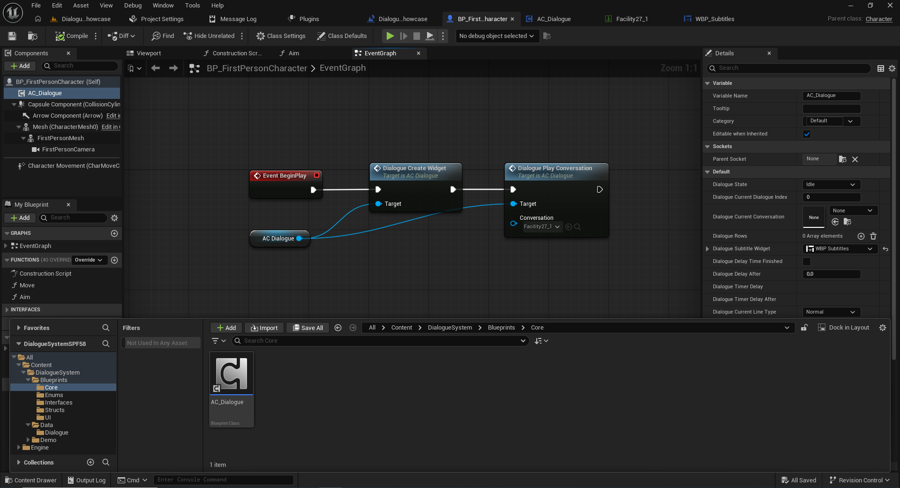

# 1. Instalación e inicio rápido

[← Volver al README](../README.md)

## Requisitos

- Unreal Engine 5 en una versión compatible con el paquete descargado desde Fab.
- Un proyecto con un Blueprint de jugador o un Actor que represente al usuario del sistema.
- El paquete **Dialogue System — Starter Pack (Free)** agregado al proyecto desde Fab.

No se requiere C++ ni un `GameInstance` personalizado.

## Paso 1. Localiza `AC_Dialogue`

En el **Content Browser**, abre:

`Content/DialogueSystem/Blueprints/Core/AC_Dialogue`

Este es el Actor Component que contiene las funciones usadas para crear la interfaz e iniciar conversaciones.

## Paso 2. Agrega el componente al jugador

1. Abre el Blueprint del jugador, por ejemplo `BP_FirstPersonCharacter` o `BP_ThirdPersonCharacter`.
2. En **Components**, pulsa **Add**.
3. Busca `AC_Dialogue` y selecciónalo.
4. Compila y guarda el Blueprint.

El componente aparecerá en la jerarquía del jugador como `AC_Dialogue` (la referencia en el gráfico puede mostrarse como `AC Dialogue`).

## Paso 3. Crea el widget de diálogo

1. Abre el **Event Graph** del Blueprint del jugador.
2. Agrega `Event BeginPlay`.
3. Arrastra una referencia de `AC_Dialogue` desde Components al gráfico.
4. Desde esa referencia, crea `Dialogue Create Widget`.
5. Conecta `BeginPlay` a la entrada de ejecución de `Dialogue Create Widget`.
6. Conecta `AC_Dialogue` al pin `Target`.

## Paso 4. Inicia la conversación

1. Desde `AC_Dialogue`, crea `Dialogue Play Conversation`.
2. Conecta la salida de ejecución de `Dialogue Create Widget` a `Dialogue Play Conversation`.
3. Conecta el mismo `AC_Dialogue` al `Target` de esta segunda función.
4. En el pin **`Conversation`**, selecciona la Data Table que contiene tu conversación.
5. Compila, guarda y ejecuta el nivel.

```text
Event BeginPlay
       │
       ▼
Dialogue Create Widget ◀── AC_Dialogue (Target)
       │
       ▼
Dialogue Play Conversation ◀── AC_Dialogue (Target)
       │
       └── Conversation: DT_TuConversacion
```

**Resultado esperado:** la conversación comienza al iniciarse el nivel. Si todavía no tienes una Data Table, continúa con la [guía de conversaciones](02-conversaciones.md).

### Ejemplo: Actor Component agregado al jugador



## Iniciar diálogos por interacción

`BeginPlay` se utiliza solo para la demostración inicial. Para iniciar el diálogo al interactuar con un NPC, llama a `Dialogue Play Conversation` desde el evento de interacción de tu proyecto, después de que la interfaz haya sido creada.

**No presupongas que todas las plantillas tienen la misma entrada de interacción.** Puede ser necesario configurar Enhanced Input y la referencia al actor correspondiente según tu plantilla.

## Compatibilidad con plantillas

La arquitectura basada en Actor Component no obliga a reemplazar el `GameInstance`, el `GameMode` o el `PlayerController`. Puedes agregar el componente al actor adecuado en First Person, Third Person u otras plantillas. Debes adaptar la forma de activar la conversación a la lógica del proyecto.


