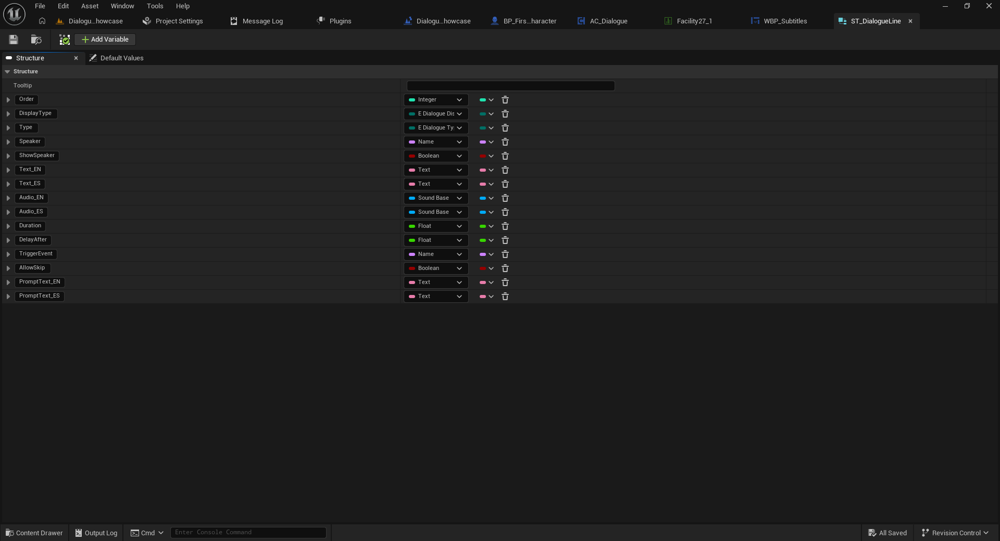
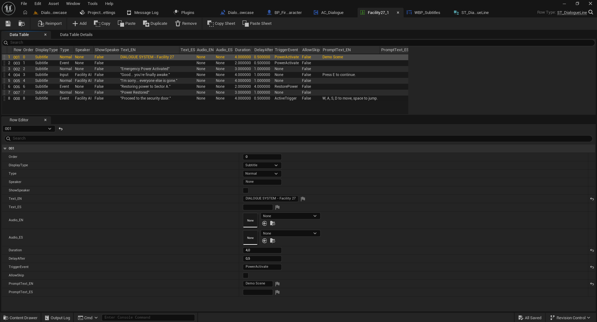

# 2. Crear conversaciones con Data Tables

[← Volver al README](../README.md)

## ¿Cómo funciona?

Cada Data Table almacena una conversación. Cada fila representa una línea o una instrucción. Las Data Tables usan la estructura **`ST_DialogueLine`**, compartida con la edición Full para facilitar la migración.

## Crear una nueva Data Table

1. En **Content Browser**, elige la carpeta donde guardarás tus conversaciones.
2. Haz clic derecho → **Miscellaneous → Data Table**.
3. Selecciona **`ST_DialogueLine`** como estructura de fila.
4. Crea el recurso, por ejemplo `DT_FirstConversation`.
5. Ábrelo, pulsa **Add** y configura cada fila en **Row Editor**.
6. Guarda la Data Table.

### Row Name y Order

- **Row Name** identifica la fila dentro de la Data Table (por ejemplo `001`, `002`, `003`).
- **Order** es la propiedad numérica destinada a establecer el orden de la conversación (por ejemplo `0`, `1`, `2`).

No son el mismo valor. Para un diálogo secuencial, utiliza valores `Order` coherentes y sin duplicados.

## Campos de `ST_DialogueLine`

| Campo | Tipo observado | Función / estado |
|---|---|---|
| `Order` | Integer | Orden de la línea. |
| `DisplayType` | Enum (`E Dialogue Display…`) | Campo de visualización; no implica que haya múltiples interfaces en Free. |
| `Type` | Enum (`E Dialogue Type…`) | Tipo de fila; en la demostración aparecen `Normal`, `Event` e `Input`. |
| `Speaker` | Name | Identificador del personaje. |
| `ShowSpeaker` | Boolean | Opción relacionada con mostrar el nombre del personaje. |
| `Text_EN` | Text | Columna de texto en inglés. |
| `Text_ES` | Text | Columna de texto en español. |
| `Audio_EN` | Sound Base | Campo de audio; funcionalidad de voces reservada a Full. |
| `Audio_ES` | Sound Base | Campo de audio; funcionalidad de voces reservada a Full. |
| `Duration` | Float | Duración de la línea en segundos. **Free y Full.** |
| `DelayAfter` | Float | Pausa posterior a la línea en segundos. **Free y Full.** |
| `TriggerEvent` | Name | Identificador del evento de juego. **Free y Full.** |
| `AllowSkip` | Boolean | Permite configurar omisión de línea **solo en Full**. Sin efecto en Free. |
| `PromptText_EN` | Text | Campo para mensaje contextual en inglés; confirmar funcionalidad específica en Free antes de usarlo. |
| `PromptText_ES` | Text | Campo para mensaje contextual en español; confirmar funcionalidad específica en Free antes de usarlo. |

> **Compatibilidad no significa disponibilidad:** `ST_DialogueLine` contiene propiedades que Free no procesa. No elimines las columnas ni cambies sus tipos: se mantienen para reutilizar las conversaciones en Full. La presencia de `Text_ES`, `Audio_EN` o `Audio_ES` no garantiza localización o voces activas en Free.

La estructura `ST_DialogueLine` contiene las propiedades
utilizadas para configurar cada línea de conversación.

## Ejemplo de conversación básica

| Row Name | Order | Type | Speaker | Text_EN | Duration | DelayAfter |
|---|---:|---|---|---|---:|---:|
| `001` | 0 | Normal | Guide | Welcome to the facility. | 3.0 | 0.5 |
| `002` | 1 | Normal | Guide | Something has gone wrong. | 4.0 | 0.5 |
| `003` | 2 | Normal | Guide | Find the generator. | 3.0 | 0.5 |

Este ejemplo asume el flujo secuencial normal y el texto en inglés. Ajusta las duraciones para facilitar la lectura.

Cada fila de la Data Table representa una línea
de diálogo o una instrucción dentro de la conversación.

## Duración y pausas

- `Duration = 4.0`: la duración configurada de esa línea es cuatro segundos.
- `DelayAfter = 0.5`: se espera medio segundo después de esa línea antes de avanzar, conforme a la lógica del sistema.

Ambos campos funcionan en las dos versiones.

## Ejecutar eventos

En `TriggerEvent`, escribe un identificador como `PowerActivate`. Ese nombre se usa para seleccionar una acción en el Blueprint receptor. Consulta la [guía de eventos](03-eventos.md).

## Usar la Data Table

En el Blueprint del jugador, después de llamar a `Dialogue Create Widget`, usa `Dialogue Play Conversation` con `AC_Dialogue` como `Target` y selecciona la nueva Data Table en `Conversation`.

