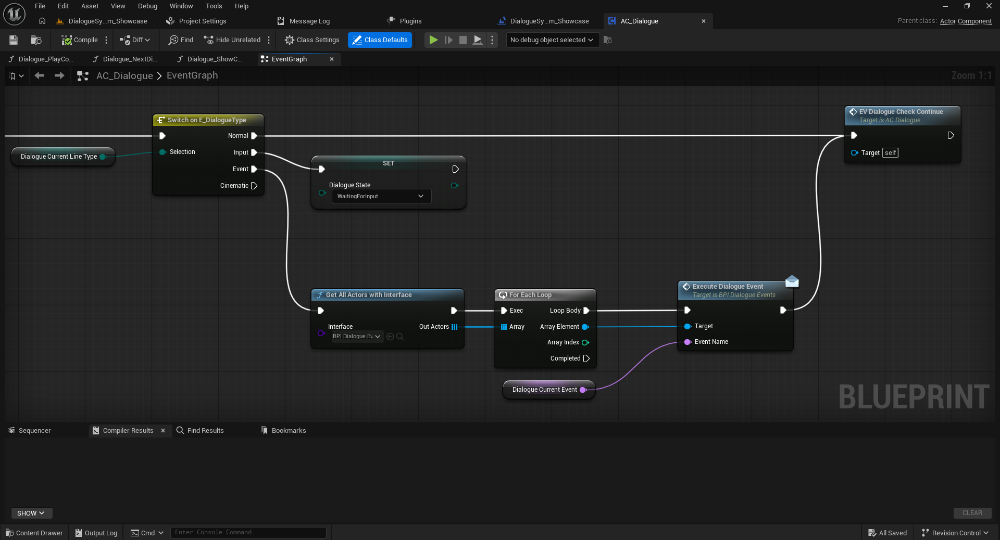
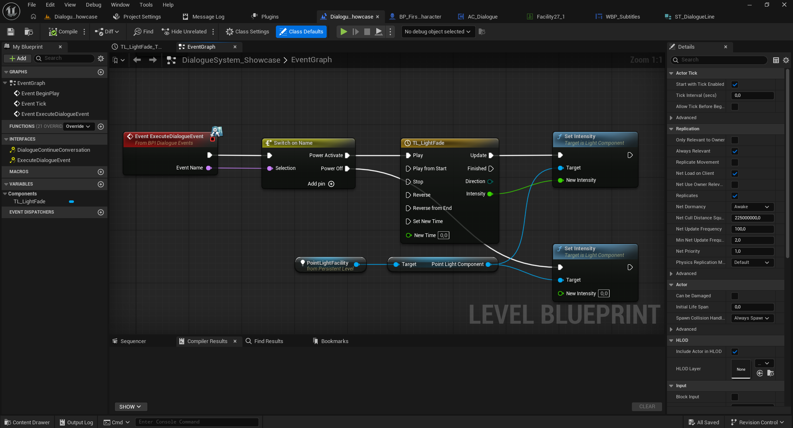
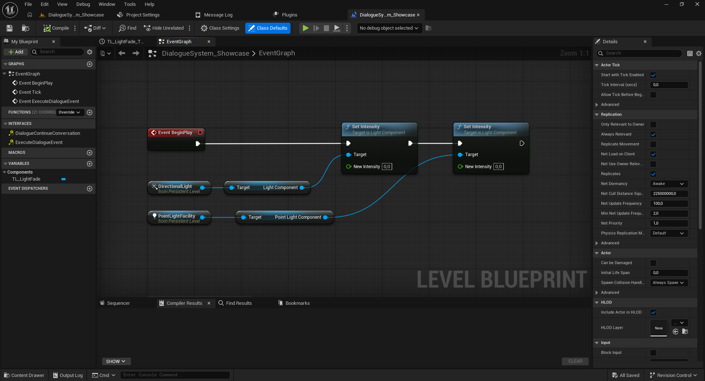
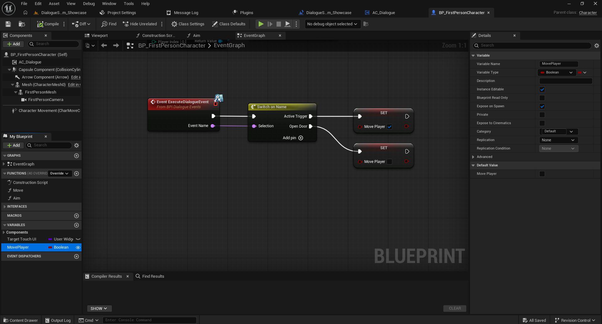

# 3. Eventos de diálogo con Blueprint Interfaces

[← Volver al README](../README.md)

**Disponible en Free y Full.** El sistema permite ejecutar acciones del juego desde filas de una conversación mediante **`BPI_DialogueEvents`**. Puedes encender luces, abrir puertas o cambiar variables sin modificar el núcleo del componente.

## Cómo envía los mensajes `AC_Dialogue`

Las capturas del Event Graph del componente confirman este recorrido cuando una fila tiene `Type = Event`:

1. El nodo **`Switch on E_DialogueType`** entra por la salida `Event`.
2. **`Get All Actors with Interface`** busca actores que implementen `BPI_DialogueEvents`.
3. **`For Each Loop`** recorre los actores encontrados.
4. **`Execute Dialogue Event`** (mensaje de interfaz) se ejecuta para cada actor, utilizando `Array Element` como `Target`.
5. La variable **`Dialogue Current Event`** llega al parámetro `Event Name` del mensaje; corresponde al identificador de evento definido para la línea de diálogo.

```text
AC_Dialogue · Switch on E_DialogueType
              └── Event
                  └── Get All Actors with Interface (BPI_DialogueEvents)
                      └── For Each Loop
                          └── Execute Dialogue Event (Message)
                              Target     = Array Element
                              Event Name = Dialogue Current Event
```

**Importante:** El mensaje se envía a **todos los actores encontrados que implementen la interfaz**, no a uno elegido específicamente por el nombre del evento. Cada receptor debe filtrar los nombres que le corresponden. Si muchos actores implementan la interfaz, todos podrán recibir el mensaje y reaccionar según su lógica.

### Envío de eventos desde AC_Dialogue

El componente `AC_Dialogue` utiliza `Get All Actors with Interface`
para localizar los actores que implementan `BPI_DialogueEvents`.

Después recorre los actores encontrados mediante `For Each Loop`
y ejecuta `Execute Dialogue Event`, enviando el identificador
almacenado en `Dialogue Current Event`.



## Paso 1. Configura el evento en la Data Table

1. Abre tu Data Table con estructura `ST_DialogueLine`.
2. Crea o selecciona una fila destinada a activar la acción.
3. En **`Type`**, selecciona **`Event`**.
4. En **`TriggerEvent`**, escribe un identificador de tipo `Name`, por ejemplo `PowerActivate`.
5. Ajusta las demás propiedades necesarias y guarda la tabla.

> `TriggerEvent` y los casos del `Switch on Name` deben coincidir exactamente. El uso de `Type = Event` es importante, porque en el gráfico del componente esa rama es la que envía los mensajes.

## Paso 2. Prepara un actor receptor

Puedes usar el **Blueprint del jugador**, un **Actor de una puerta o mecanismo**, u otro actor que deba responder a la conversación. En la demostración también se muestra una implementación en el **Level Blueprint**.

1. Abre el Blueprint del actor receptor.
2. En **Class Settings → Interfaces → Implemented Interfaces**, pulsa **Add**.
3. Selecciona **`BPI_DialogueEvents`**.
4. Compila y guarda.
5. En el Event Graph, añade **`Event ExecuteDialogueEvent`**.
6. Conecta su ejecución a **`Switch on Name`** y su pin **`Event Name`** a **`Selection`**.
7. Agrega los casos que deba manejar ese actor.

```text
Event ExecuteDialogueEvent (from BPI_DialogueEvents)
    Exec ───────────────────► Switch on Name
    Event Name ─────────────► Selection
                                ├── PowerActivate → Acción de encendido
                                ├── PowerOff      → Acción de apagado
                                └── OpenDoor      → Abrir puerta
```

**No es necesario agregar una llamada manual al actor receptor desde `AC_Dialogue`:** el componente descubre los actores que implementan la interfaz y les envía el mensaje. Verifica que el actor receptor exista en el mundo al momento del evento.

## Ejemplo A. Encender o apagar una luz (Level Blueprint)

El ejemplo del proyecto utiliza una referencia a `PointLightFacility`, su `Point Light Component` y la Timeline `TL_LightFade`.

- Caso **`PowerActivate`**: ejecuta `Play` de `TL_LightFade`. La salida `Update` llama a `Set Intensity`, utilizando `Intensity` como valor de intensidad.
- Caso **`PowerOff`**: llama a `Set Intensity` con `New Intensity = 0`.

El ejemplo demuestra cómo un evento de una conversación controla un elemento del nivel. Si reproduces esta configuración en otro mapa, comprueba que el receptor concreto está siendo descubierto por `Get All Actors with Interface`.

### Ejemplo: controlar luces mediante eventos

En este ejemplo, el Level Blueprint recibe
`Event ExecuteDialogueEvent`.

El nodo `Switch on Name` identifica el evento recibido:

- `PowerActivate`: ejecuta una Timeline para encender la luz.
- `PowerOff`: establece la intensidad de la luz en cero.




## Ejemplo B. Activar o desactivar una variable del jugador

En `BP_FirstPersonCharacter`, con `BPI_DialogueEvents` agregada a **Implemented Interfaces**, el ejemplo mostrado usa `Event ExecuteDialogueEvent` y `Switch on Name`:

- Caso **`ActiveTrigger`**: `Set MovePlayer = true`.
- Caso **`OpenDoor`**: `Set MovePlayer = false`.

Estos son **ejemplos de nombres y efectos del proyecto de demostración**: utiliza identificadores que coincidan con tus propias filas de Data Table. El caso `OpenDoor` de esta captura cambia una variable booleana; **no abre una puerta por sí mismo**.

### Ejemplo: recibir eventos en el jugador

También podemos implementar `BPI_DialogueEvents`
directamente en el Blueprint del personaje.

En `BP_FirstPersonCharacter`, el evento
`ExecuteDialogueEvent` utiliza `Switch on Name`
para modificar la variable `MovePlayer`.

- `ActiveTrigger`: activa `MovePlayer`.
- `OpenDoor`: desactiva `MovePlayer`.



## Diagnóstico si no llega el evento

1. Verifica que la conversación pase por una fila con `Type = Event` y `TriggerEvent` definido.
2. Confirma que el nombre sea idéntico al caso del `Switch on Name`.
3. Confirma que el actor **implemente** `BPI_DialogueEvents`, esté cargado y exista en el mundo.
4. Coloca un `Print String` temporal en `Event ExecuteDialogueEvent` para ver si se llama.
5. Si el evento se recibe pero no hay efecto, revisa la lógica después del Switch y las referencias a los componentes.
6. Si varios actores reaccionan inesperadamente, recuerda que el mensaje llega a todos los encontrados con esa interfaz: filtra por nombre dentro de cada actor.


